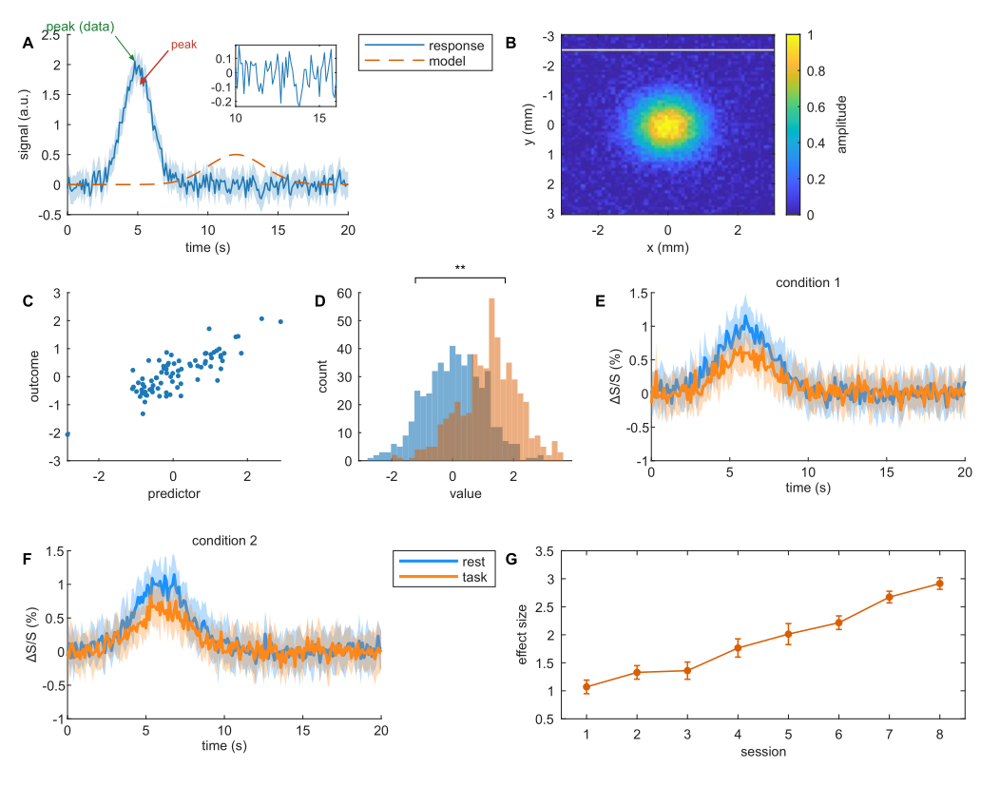
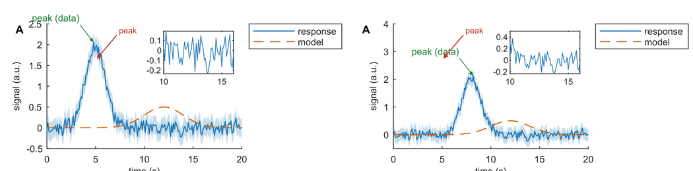

<!-- summary: measured evaluation of the figurefirst model for PNAS figures from MATLAB (prototype in src/), 2026-11-02: geometry, fonts, regeneration, edit loop, R1 vs R2, cost; verdict adapt, route R2 -->
# Evaluation: the figurefirst model for Seb's manuscript figures (2026-11-02)

Prototype: `src/` (MATLAB functions plus one Python helper), example: `examples/makeFig1.m` with
`examples/fig1_layout.svg`, tests: `test/` (`run_all.m` runs all four; 82 s). Everything was
measured on tako with MATLAB R2025a Update 1 (`matlab -batch`, X display present,
`ScreenPixelsPerInch` = 95), Inkscape 1.2.2, librsvg 2.60.2, pypdf 6.21, mutool 1.23. All data is
synthetic.

*The example: 178 × 140 mm, seven panels (line plus band with its legend in its own box, an
inset, `imagesc` with its colorbar in its own box, scatter, two histograms, two tiles adopted
from a function that builds its own `tiledlayout`, error bars). Hand-drawn layers: panel
letters, an arrow and label, a bracket with stars. Rendered by R2.*

## Verdict: adapt

The model works and is worth building on. Geometry is exact to MATLAB's own pixel grid. Every
kind of MATLAB content works, because nothing parses MATLAB's output. Hand layers survive
byte-for-byte, and the code is half the size of matlab2manuscript. Four things must be adapted
before Seb's real figures, in order of cost:

1. **Image panels:** MATLAB rasterizes images at screen resolution (95 ppi) even in
   vector export. Not built yet; it is the main blocker for figures 2 and 3.
2. **Annotations tied to data drift** when data or limits change (9 to 12 mm here). Mitigated:
   data-anchored arrows drawn by MATLAB, plus a warning that names the suspect annotations
   and repeats until acknowledged.
3. **Font sizes snap to the pixel grid** (7 pt prints as 6.82 pt; 6 pt as 5.31 pt, below
   PNAS's minimum). Mitigated: sizes that would print under 6 pt are raised automatically; a
   PDF lint checks the result.
4. **Things tied to a box do not follow it** when the box is moved in Inkscape (its letter,
   inset, legend box). Seb moves them together (select, then drag), or MATLAB draws the letters.

**Route: R2** (MATLAB PDF plus a stamped annotation PDF). R1 and R2 give the same geometry, the
same fonts and pixel-identical renders. R2 never touches MATLAB's SVG exporter, the class of
problem matlab2manuscript fought for two months. R1 is kept as an option: a smaller file, plus
an SVG of the final figure.

## How it works (as built)

- **Layout SVG**, drawn in Inkscape at the journal width:
  - Layer `layout` holds the boxes. Each `<rect>` is one box, named by its Inkscape label
    (Objects panel). A box is an axes plot box, or a colorbar (`B.cb`), or a legend position
    (`A.leg`); the panel code says which.
  - Layer `generated` is owned by the pipeline.
  - Every other layer belongs to Seb and is never written (here: `annotations`, `letters`).
- **MATLAB:**
  - `fig = m2mPage(layout)` makes one invisible figure at the exact page size, Arial 7 pt,
    light theme.
  - `m2mAxes(fig, 'A')` makes an axes whose plot box is box A.
  - `m2mAdopt(fig, 'E', srcAx)` copies an axes from existing plotting code, with its legend
    and colorbar.
  - `m2mColorbar(ax, 'B.cb')` and `m2mLegend(lg, 'A.leg')` place a colorbar or legend in its
    box.
  - `m2mDataArrow(ax, xy, offsetMm, label)` adds a data-anchored annotation.
- **`m2mExport(fig, 'fig1.pdf')`:**
  1. Loud errors: a box with no code, code with no box, a stray axes.
  2. Re-applies every box, so `plot()` resets cannot move one, and stacks axes in layout
     z-order (insets on top).
  3. Checks: overlaps between neighbours (tick and axis labels included), anything off the
     page, legend overflow, data or limit changes under hand annotations.
  4. Renders (R2 or R1).
  5. Lints the final PDF: page size, fonts, text ≥ 6 pt, strokes ≥ 0.25 pt, images ≥ 300 ppi.
  6. Writes a preview PNG, which the `generated` layer links to.
- **`src/m2m_svg.py`** (standard library; `overlay` needs pypdf) holds the SVG and PDF
  operations. MATLAB calls it through `system()`. MATLAB's `LD_LIBRARY_PATH` is dropped so
  that `rsvg-convert` works.

## 1. Layout parsing

`test/test_layout.py` edits the example layout with **real Inkscape 1.2.2 CLI actions** (the
transform code the select tool uses), saves it as Inkscape SVG, and compares every box
`m2m_svg.py` reads with Inkscape's own `--query-all` geometry. Result: **14/14 cases pass;
max |m2m − Inkscape| = 1.3 × 10⁻⁴ mm** (the precision of Inkscape's output).

| Edit in Inkscape | What Inkscape writes to the rect | m2m |
|---|---|---|
| Move | rewrites `x`, `y`; adds no transform | exact |
| Scale ×1.25 | rewrites `x`, `y`, `width`, `height`; adds `stroke-width:1.25` to the style | exact |
| Grow by 3 px | rewrites all four | exact |
| Rotate 90° | **adds `transform="rotate(90)"`**, rewrites `x`, `y` | exact (any multiple of 90° gives an axis-aligned box) |
| Rotate 30° | adds `rotate(30)` | **loud error** naming the box |
| Duplicate (Ctrl+D) | new id, **same label** | **loud error**: duplicate name |
| Duplicate, then relabel | — | new box |
| Delete | — | box gone |
| Layer with `translate(5,3)`, rect moved | rect `x`/`y` in layer coordinates; layer transform kept | exact |
| Group scaled | **transform on the group**, rect untouched | exact (full ancestor chain) |
| px-unit document (viewBox in px, mm width) | — | exact |
| Rect without a label | — | **loud error** |

Units: the page size comes from `width`/`height` (mm, cm, in, pt, pc, px) and the viewBox. Box
geometry is the rect's geometric box. Inkscape's toolbar shows the *visual* box (stroke
included), so the boxes should have no stroke (the example uses a translucent fill), or Seb
switches Inkscape to geometric bounding boxes.

## 2. Rendering routes

| | R1: SVG route | R2: PDF route (recommended) |
|---|---|---|
| Steps | `print -dsvg` → page SVG becomes the `generated` layer of a copy of the layout (one `matrix()` maps MATLAB pt to layout mm; MATLAB ids prefixed) → `rsvg-convert` | `print -dpdf -vector` → human layers to a transparent PDF (`rsvg-convert`) → pypdf crops MATLAB's page to the exact size and stamps the annotation page on top |
| MATLAB SVG parsed? | no (wrapped whole) | never produced |
| Page size | 178.0000 × 139.9999 mm | 178.0000 × 139.9999 mm |
| Box accuracy | worst 0.234 mm | worst 0.234 mm (same numbers to 0.001 mm) |
| Fonts | ArialMT and Arial-BoldMT subsets (librsvg) | ArialMT, *full* font (MATLAB), plus subsets for the annotations |
| Renders vs each other | — | 33 of 3.5 M pixels differ at 25% fuzz (antialiasing only) |
| File size (example) | 70 KB | 205 KB (MATLAB embeds the whole Arial) |
| Export time | print 1.2 s + inject and render 0.15 s | print 1.2–1.6 s + annotations 0.09 s + overlay 0.2 s |
| Extra dependency | — | pypdf (in `~/opt/mat2manu-py`) |
| Extra output | the final figure as an SVG (opens in Inkscape) | — |

R2 is recommended because MATLAB's PDF printer is its mainstream vector path and R2 never
touches MATLAB's SVG. The quirks that matter (pixel grid, font flooring, image rasterization)
turned out identical in both routes. R2 has two costs: a third-party PDF library, and MATLAB
rounding its page *up* to whole points (505 × 397 bp for 504.57 × 396.85). It anchors content
at the top-left, so the crop is exact: verified against MATLAB's uncropped page at five page
heights, mean edge error under 0.1 mm.

Overlay tools considered: qpdf and pdftk are not installed on tako. pdfpages/LaTeX works but is
heavy. mutool can't overlay without scripting. pypdf (pure Python, venv) was chosen.

## 3. Accuracy (`test/test_accuracy.m`)

Each plot box is painted a unique colour, then found in the final PDF with `mutool trace`.

- **Boxes: every edge within one MATLAB pixel (0.267 mm at 95 ppi); worst 0.234 mm,
  typically 0.1–0.15 mm.** That holds for all eight axes boxes and the colorbar box, and is
  identical in both routes. MATLAB snaps every position to its screen-pixel grid
  (1/`ScreenPixelsPerInch` inch), in `print`, `exportgraphics` and `-dsvg` alike, whatever the
  `-r` or `Resolution` (tested). There is no correctable systematic offset: page heights from
  100 to 200 mm give mean errors between −0.05 and +0.1 mm, changing sign.
- **Page:** exactly 178.000 × 140.000 mm after R2's crop, and from R1.
- **Fonts:**
  - **ArialMT is embedded as real text** in both routes, as long as `FontName` is Arial
    (`m2mPage` sets the figure defaults; `m2mAdopt` forces it on copied axes).
  - **TeX markup breaks this:** `'\Delta'` in a label embeds MATLAB's Computer Modern
    (`mwb_cmr10`). The lint caught it. Fix: `char(916)` with `'Interpreter','none'`.
- **Font sizes, measured in the PDF:**
  - MATLAB prints a size *s* as `floor(s·95/72)` pixels, so: 7 → **6.82 pt**, 6 → **5.31 pt**.
  - Colorbar and legend text default to 90% of the axes size (6.3 → 6.06 pt). `m2mColorbar`
    and `m2mExport` set them to the page size instead.
  - With `enforceMinText` (on by default) nothing prints under 6 pt: the inset's 6 pt became
    6.06 pt.
  - Hand-drawn text from Inkscape keeps its exact size (6.00, 7.00, 8.00 pt).
- **Line widths:** exact (0.5 pt axes, 0.75 pt data). Adopted axes keep their source's line
  widths (1.5 pt here).
- **Images: 95 ppi.** MATLAB's "vector" PDF and SVG rasterize every image (data images and the
  colorbar gradient) at screen resolution: 142 × 121 pixels for a 38 mm box, whatever the
  data size or `-r`/`Resolution` setting (tested 64 to 512 rows, `-r600`,
  `exportgraphics Resolution=600`). Two consequences:
  - PNAS's ≥ 300 ppi rule fails (the lint flags it).
  - A **white seam artifact** appears in a plain 64-row `imagesc`, reproduced with MATLAB
    alone (no m2m code involved). It is visible in panel B.

**Running fully headless is not an option on tako.** Without `DISPLAY`, `ScreenPixelsPerInch`
is 72, which would give exact integer-pt fonts on a 0.35 mm grid. But `print -dpdf` and
`exportgraphics` then hang: three variants all hit a 60 s timeout, even on a bare figure. So
the 95 ppi grid is the working condition, and output depends on whether a display is set.

## 4. Regeneration (`test/test_regenerate.m`)

Three runs on panel A: base (peak at t = 5 s, ylim [−0.5 2.5]); limits only (ylim [−0.5 4]);
data and limits (peak at 8 s).

- **The human layers survive untouched:** C14N hashes are identical across all runs. The layout
  file is not even rewritten after the first run (the preview link is already in place), and
  the hand-drawn arrow lands at the same place in every PDF (moved 0.000 mm).
- **Drift, inherent to the model:** the data under the hand-drawn arrow moved **9.08 mm** for a
  limits-only change, and **12.08 mm** for data plus limits, in a 50 × 32 mm box.

*Left: base. Right: after data and limits changed. The hand-drawn red arrow (Inkscape) points
at empty space; the green data-anchored arrow (m2mDataArrow) follows the peak.*

**Mitigation, built and tested:**

1. **Data-anchored annotations drawn by MATLAB.** `m2mDataArrow(ax, [x y], [dx dy] mm, label)`:
   the tip is a data point, the tail an offset in mm. It is drawn at export with the final box
   and limits. It tracked the peak to **0.02 mm** in both changed runs. Rule of thumb: anything
   that points *at data* belongs in MATLAB; anything about the *figure* (letters, brackets
   between panels, schematics) belongs in Inkscape.
2. **Detection of the rest.** `m2mExport` keeps per-panel axis limits and an MD5 of the plotted
   data in `<out>.m2mstate.json`. When either changes, it asks Inkscape (`--query-all`) for the
   real bounding boxes of the hand-drawn objects and names those over that panel:
   `arrowA (layer annotations) over panel A; noteA (...)`. The baseline stays until Seb passes
   `opts.ackChanges = true`, so the warning repeats on every run instead of vanishing after
   one (tested).

## 5. The edit loop (`test/test_editloop.m`)

Real Inkscape edits: move A by (6, 2) mm, scale D by 1.15, delete G, duplicate C and relabel it
H, then move H into G's place. Re-run:

| Situation | Result |
|---|---|
| Code still draws G | `m2m:noBox`: *Panel code asks for box "G", which the layout … does not have. Boxes in the layout: A, A.leg, … H. Draw a rect labelled "G" …* |
| G skipped, H has no code | `m2m:unusedBox`: *Layout box(es) with no panel code: H. Delete the rect(s) …, fill them …, or pass opts.allowUnused.* |
| Code for H added | renders; A, D and H land where Inkscape put them, **worst 0.234 mm** |
| A box rotated 15° | `m2m:svg`: *box "E" (id boxE) is rotated or skewed … Remove the rotation* |
| A box duplicated | `m2m:svg`: *duplicate box name(s): C* |
| An axes created with plain `axes()` | `m2m:foreignAxes` |
| A legend outside its box overlaps a neighbour | warning: *G and F legend (no box) overlap (labels included) by 15.0 x 6.6 mm*. Found while building the example: the fix was an `F.leg` box. |

**Not followed automatically:** moving box A in the test left its letter, its inset and its
legend box behind (in the GUI Seb selects them together). See open question 3.

## 6. Realistic content

| Content | Status |
|---|---|
| Line + error band (`fill`, FaceAlpha) | works |
| `imagesc` + colorbar in its own box | geometry works; **image at 95 ppi plus seam** (§3) |
| Scatter, histogram (two, transparent), errorbar | work, with no code specific to them (they were blockers for matlab2manuscript's matchers: figures 3 and 5) |
| Legend in its own box | works; the box sets the top-left corner, natural size kept, overflow warned (*Legend in box A.leg is 4.9 mm larger*) |
| Inset axes | works: a box inside a box; later rect = on top; the overlap check skips nested boxes |
| Tick labels spilling | labels spill outside the box as intended; `tightPosition(IncludeLabels)` finds overlaps between panels and anything off the page |
| **Adopting existing plotting code** (own figure + `tiledlayout`, dark style, 12 pt fonts, `eastoutside` legend) | works with `m2mAdopt`: copyobj with legend and colorbar, box re-applied, fonts forced to the page font and size, light theme of the page |
| A colorbar in the `tiledlayout`'s east tile (as in `makeFigx5.m`) | comes along with its owning axes (`ax.Colorbar` still points to it) |
| `yyaxis` | loud error (copyobj cannot copy it); draw with `m2mAxes` |
| `polyshape` outlines, stacked images (figure 2) | **not tested** |

## 7. Cost

- **Code** (non-comment lines): MATLAB 580 (`m2mExport` 294) and Python 399. About **1,000
  lines in all, against matlab2manuscript's 1,865**, which had no multi-panel figure, no PDF
  path and no real-editor test.
- **Runtime per figure:**
  - About 10 s MATLAB startup, once per session.
  - Plotting: the caller's.
  - `m2mExport`: **4–7 s**. Print 1.2–1.6 s, render 0.1–0.3 s, lint 0.1 s, preview PNG
    1.5 s, and an Inkscape query (0.4 s) only when data changed under annotations.
- **What Seb does by hand:** draw and name boxes, with no stroke. Write panel code that names
  its boxes. Draw letters and figure-level marks in his own layers. Re-run MATLAB to see a
  layout change. Check and acknowledge drift warnings.
- **Failure modes:** all loud, except the two silent ones that the lint catches afterwards
  (TeX fonts, image ppi):

| Failure | Behaviour |
|---|---|
| Name mismatch either way, duplicate or unlabeled rect, rotated rect, stray axes | error |
| Labels colliding or off the page, legend too big, data changed under annotations, small text, thin strokes, low-ppi images, wrong fonts, page size | warning (in `info.warnings` too) |
| Inkscape open with unsaved edits while MATLAB writes the layout | only possible on the first run (link insertion); later runs never write the file |

**What is lost compared with matlab2manuscript:**

- You drag an empty box, not the rendered panel.
- The rendered panel shows in Inkscape only after a re-run, as a linked preview PNG in the
  locked `generated` layer. Inkscape's auto-reload of linked images (on by default) should
  refresh it; that could not be verified headless.
- There are no semantic groups in the output: one trace cannot be selected and restyled in
  Inkscape. That narrowing was already decided in the predecessor's strategy (§2).
- The first preview write re-serializes the layout file: it drops a comment before `<svg>`
  and adds spaces before `/>`. Content is unchanged; Inkscape's own save does the same.

**What is gained:**

- No decoding of MATLAB output at all, so any plot type works.
- One coordinate truth, the rects.
- Geometry exact to the pixel grid, on a multi-panel page.
- A real Inkscape round trip, tested. It was never closed for matlab2manuscript.

## Open questions for Seb

1. **Route:** R2 as the default, R1 as an option?
2. **Image panels (blocks figures 2 and 3):** which fix to build?
   - (a) **A raster underlay** (recommended): render only the images at 600 ppi (everything else
     hidden) and stamp them under the vector page, a third layer in R2.
   - (b) **Vector pixels** (`surface` with flat faces): exact data pixels, but hairline seams in
     some viewers (seen in poppler).
3. **Panel letters:** keep them hand-drawn (move each with its box), or have MATLAB draw them at
   a fixed offset from each box (they then follow moves; per-letter tweaks are lost)?
4. **Font sizes** sit on the 95 ppi grid: "7 pt" prints as 6.82 pt. Accept that, request
   sizes on the grid (6.06 / 6.82 / 7.58 pt), or install Xvfb so MATLAB runs at 72 ppi
   (exact integer sizes, 0.35 mm position grid)? It is not installed; that needs root.
5. **Python:** pypdf lives in a venv (`~/opt/mat2manu-py`). Fine on tako; does any of this
   need to run on the Mac?

## Notes on conventions

- The page figure is made invisible and its `Position` is set to the exact page size. That is
  an exception to the "no `figure('Position')`" rule, which exists because interactive figures
  undock; an invisible page figure never docks, and exact size is the point.
- Manuscript figures are white with dark text (PNAS), not the dark diagnostic style.
  `m2mPage` forces the light theme; tako's default dark theme draws tick labels light grey
  (#d9d9d9), which was measured in the first probe.
